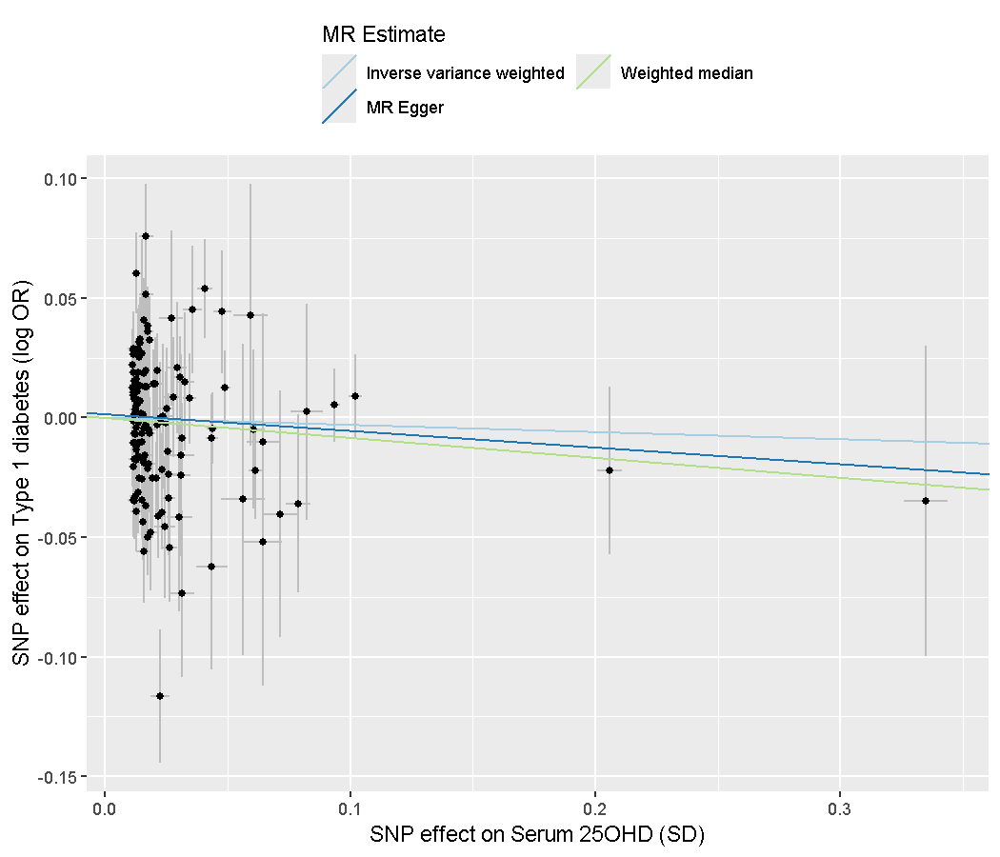

[](https://www.r-project.org/)
[](LICENSE)

# mr-vitamin-d-type1-diabetes v1.0.0

## Two-sample Mendelian randomization of serum 25-hydroxyvitamin D on type 1 diabetes, from public GWAS summary statistics

**Version:** 1.0.0
**Release Date:** November 5, 2026
**R:** 4.5 or later (developed on 4.5.3, TwoSampleMR 0.7.12)

---

## Table of Contents

- [Overview](#overview)
- [System Requirements](#system-requirements)
- [Installation](#installation)
- [Usage](#usage)
- [Architecture](#architecture)
- [Troubleshooting](#troubleshooting)
- [Limitations](#limitations)
- [Support](#support)
- [Changelog](#changelog)
- [Citations](#citations)
- [Author](#author)

---

## Overview

This repository is a learning exercise: a complete two-sample Mendelian randomization (MR) analysis written in R by a first-year nutrition student with no prior R experience. It asks whether genetically predicted serum 25-hydroxyvitamin D (25OHD) changes the risk of type 1 diabetes, a question already studied in the literature, using the same estimators a published analysis would use. It is not a research result and makes no causal claim.

### Key Capabilities

- **Tokenless data access** - both datasets are streamed from the GWAS Catalog FTP; no account or API token is needed
- **Instrument selection** - genome-wide significant variants (p < 5e-8), greedy positional pruning, F-statistic filter (F >= 10)
- **Three estimators** - inverse-variance weighted (IVW), weighted median, MR-Egger
- **Sensitivity analyses** - Cochran's Q heterogeneity, MR-Egger intercept, leave-one-out, single-variant Wald ratios
- **HLA sensitivity analysis** - repeats the analysis without the HLA region, which would otherwise dominate the signal
- **Figures and tables** - scatter, forest, leave-one-out and funnel plots, plus CSV tables of every estimate
- **Plain-language explainer** - `docs/methode-et-resultats.md` explains the method and the results (in French)

---

## System Requirements

- **R:** 4.5 or later, with the packages `TwoSampleMR`, `data.table`, `ggplot2`
- **Disk:** about 2.5 GB for the type 1 diabetes download (kept in `data/raw/`, not tracked by git)
- **Memory:** 4 GB or more

### External Tools

- `bash`, `curl`, `gzip` and `awk` on `PATH` (Git Bash provides all four on Windows)
- Network access to `ftp.ebi.ac.uk`

---

## Installation

```bash
# 1. Clone the repository
git clone https://github.com/DeltaGa/mr-vitamin-d-type1-diabetes.git
cd mr-vitamin-d-type1-diabetes

# 2. Install the R packages (TwoSampleMR is distributed through the MRC IEU r-universe)
Rscript -e 'options(repos = c(mrcieu = "https://mrcieu.r-universe.dev", CRAN = "https://cloud.r-project.org")); install.packages(c("TwoSampleMR", "data.table", "ggplot2"))'
```

---

## Usage

### Basic Usage

```bash
# Run the full pipeline: download, select instruments, run MR, write results/
bash run_all.sh
```

The type 1 diabetes download is large and the server is sometimes slow. The download resumes if interrupted; run the script again.

### Advanced Usage

```bash
# Run one stage at a time
bash scripts/fetch_exposure.sh        # 25OHD statistics, filtered to p < 5e-8
Rscript R/01_select_instruments.R     # pruning and F-statistic filter
bash scripts/fetch_outcome.sh         # type 1 diabetes rows for the instruments
Rscript R/02_run_mr.R                 # estimators, sensitivity analyses, figures
Rscript R/03_sensitivity_no_hla.R     # same analysis without the HLA region
```

### Results

Run of November 5, 2026, fixed random seed (OR per 1 SD of serum 25OHD). A plain-language walkthrough of the method and of these results is in [docs/methode-et-resultats.md](docs/methode-et-resultats.md) (in French).

Main analysis, 140 instruments:

| Method | SNPs | OR (95% CI) | p |
|--------|------|-------------|---|
| Inverse variance weighted | 140 | 0.993 (0.762 to 1.292) | 0.956 |
| Weighted median | 140 | 0.921 (0.776 to 1.092) | 0.343 |
| MR-Egger | 140 | 0.904 (0.611 to 1.337) | 0.613 |

- Cochran's Q (IVW): 760.1, 139 df, p = 2.7e-86
- Egger intercept: 0.0034 (SE 0.0054), p = 0.525

One instrument, rs9272539, lies in the HLA region (the dominant type 1 diabetes locus) and drives the heterogeneity. Sensitivity analysis without the HLA region (chr 6, 25-34 Mb; rs1321247 and rs9272539 removed), 138 instruments:

| Method | SNPs | OR (95% CI) | p |
|--------|------|-------------|---|
| Inverse variance weighted | 138 | 0.971 (0.830 to 1.135) | 0.710 |
| Weighted median | 138 | 0.920 (0.768 to 1.102) | 0.365 |
| MR-Egger | 138 | 0.933 (0.740 to 1.176) | 0.559 |

- Cochran's Q (IVW): 261.6, 137 df, p = 8.0e-10
- Egger intercept: 0.0014 (SE 0.0032), p = 0.650

No estimate is statistically significant and the three methods agree in direction with overlapping intervals. Heterogeneity remains large after the HLA removal, so these results do not support a causal claim either way.



| Figure | File |
|--------|------|
| Scatter, main analysis | `results/scatter.png` |
| Scatter, without HLA | `results/scatter_no_hla.png` |
| Single-variant forest plots | `results/forest.png`, `results/forest_no_hla.png` |
| Funnel plots | `results/funnel.png`, `results/funnel_no_hla.png` |
| Leave-one-out | `results/leave_one_out.png` |

Tables of every estimate are in `results/*.csv`.

---

## Architecture

| Component | Responsibility |
|-----------|----------------|
| `scripts/fetch_exposure.sh` | Streams the harmonised 25OHD file and keeps variants with p < 5e-8 |
| `R/01_select_instruments.R` | Prunes to one variant per 500 kb window, drops weak instruments |
| `scripts/fetch_outcome.sh` | Downloads the type 1 diabetes file once, extracts the instrument rows |
| `R/02_run_mr.R` | Harmonises alleles, runs the estimators and sensitivity analyses, writes figures |
| `R/03_sensitivity_no_hla.R` | Repeats the estimators without the HLA region, writes the `*_no_hla` outputs |
| `docs/methode-et-resultats.md` | Plain-language explanation of the method and results (French) |
| `run_all.sh` | Runs the four stages in order |

```
mr-vitamin-d-type1-diabetes/
+-- README.md
+-- LICENSE
+-- run_all.sh
+-- scripts/    fetch_exposure.sh, fetch_outcome.sh
+-- R/          01_select_instruments.R, 02_run_mr.R, 03_sensitivity_no_hla.R
+-- docs/       methode-et-resultats.md
+-- data/       instruments.tsv, outcome_instruments.tsv  (raw downloads are not tracked)
+-- results/    estimates, tables, figures
```

---

## Troubleshooting

### The type 1 diabetes download is very slow

**Cause:** the GWAS Catalog FTP serves large files at a few hundred kilobytes per second at busy times, and range requests into the file are not usable because it is a plain gzip, not an indexed one.
**Solution:** leave `scripts/fetch_outcome.sh` running; `curl -C -` resumes from the bytes already on disk.

### Rscript fails to start on Windows with a conda-installed R

**Cause:** the conda environment's `Library/bin` and `lib/R/bin/x64` folders are not on `PATH`.
**Solution:** prepend both folders to `PATH` before calling `Rscript`.

---

## Limitations

- Independence between instruments is approximated by positional pruning (500 kb windows), not by linkage disequilibrium clumping against a reference panel. Residual correlation between instruments is possible.
- The exposure and outcome studies both draw on UK Biobank participants, so sample overlap may bias the estimate toward the observational association.
- No Steiger directionality filter, MR-PRESSO or multivariable analysis is run. These are the natural next steps.
- Heterogeneity stays significant after removing the HLA region; other pleiotropic instruments probably remain.
- Single analysis on European-ancestry data; no replication.
- The output is a demonstration of method, not evidence about vitamin D and type 1 diabetes.

---

## Support

- **Issues:** open an issue in this repository's GitHub issue tracker
- **Contact:** see the Author section

---

## Changelog

### Version 1.0.0 (November 4, 2026)

- First full run executed on November 4, 2026; results committed in `results/`
- Initial release: instrument selection, IVW, weighted median, MR-Egger, heterogeneity, intercept, leave-one-out, single-variant analyses and plots

---

## Citations

- [**TwoSampleMR**](https://mrcieu.github.io/TwoSampleMR/): Hemani G, Zheng J, Elsworth B, et al. The MR-Base platform supports systematic causal inference across the human phenome. eLife 2018.
- [**GWAS Catalog GCST90000618**](https://www.ebi.ac.uk/gwas/studies/GCST90000618): serum 25-hydroxyvitamin D summary statistics, European ancestry, n = 496,946 (Revez JA et al., Nature Communications 2020).
- [**GWAS Catalog GCST90014023**](https://www.ebi.ac.uk/gwas/studies/GCST90014023): type 1 diabetes summary statistics (Chiou J et al., Nature 2021).
- [**GWAS Catalog**](https://www.ebi.ac.uk/gwas/): EMBL-EBI, source and harmonisation of both files.

---

## Author

**Tchicdje Kouojip Joram Smith (DeltaGa)**
Email: dev.github.tkjoramsmith@outlook.com
GitHub: [https://github.com/DeltaGa](https://github.com/DeltaGa)

---

© 2026 DeltaGa. All rights reserved.
