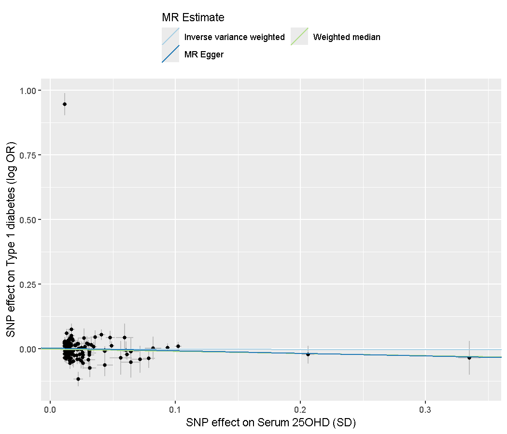
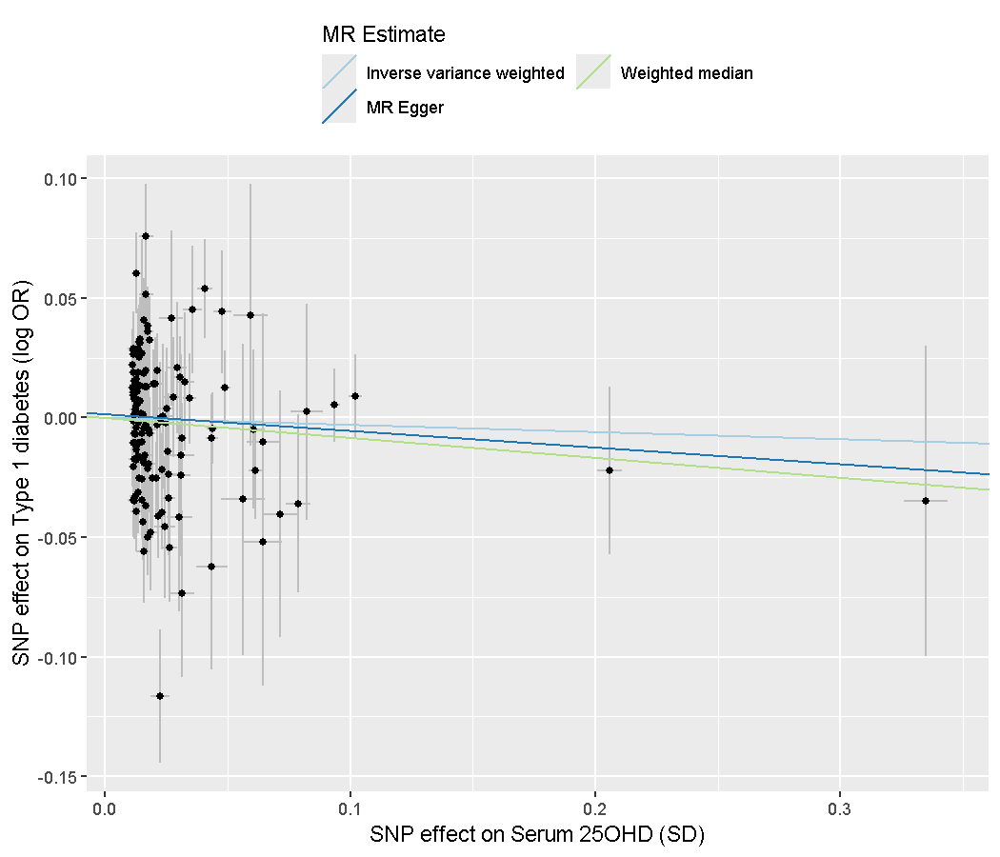

# La randomisation mendélienne expliquée : vitamine D et diabète de type 1

Ce document explique, sans jargon inutile, ce que fait ce dépôt, pourquoi la méthode existe et ce que les résultats permettent (et ne permettent pas) de dire. C'est un exercice d'apprentissage, pas une étude : aucune conclusion causale n'en découle.

---

## 1. La question

Les personnes qui ont peu de vitamine D dans le sang ont-elles plus de diabète de type 1 (DT1) ? Les études d'observation répondent souvent « oui, un peu ». Mais elles butent sur deux pièges :

- **Les facteurs de confusion.** Les gens qui manquent de vitamine D diffèrent des autres : moins de soleil, autre alimentation, autre état de santé. Difficile de savoir si c'est la vitamine D ou tout le reste.
- **La causalité inverse.** Être malade peut faire baisser la vitamine D, et non l'inverse.

Un essai randomisé trancherait, mais donner ou retirer de la vitamine D pendant des décennies à des milliers d'enfants est irréaliste.

## 2. L'idée de la randomisation mendélienne

À la conception, chacun reçoit de ses parents des variantes génétiques tirées « au hasard ». Certaines variantes font légèrement monter ou descendre la vitamine D dans le sang, toute la vie. C'est comme un essai randomisé fait par la nature :

1. Les variantes sont distribuées au hasard, donc elles ne dépendent pas du mode de vie.
2. Elles sont fixées à la naissance, donc la maladie ne peut pas les modifier.

On compare alors : les gens dont les gènes prédisent plus de vitamine D ont-ils moins de DT1 ? Si oui, c'est un indice de cause. La variante joue le rôle d'un « bras de traitement » naturel, qu'on appelle un **instrument**.

## 3. Les étapes du dépôt

| Étape | Ce qui se passe | Fichier |
|-------|-----------------|---------|
| 1. Données de la vitamine D | Une grande étude (près de 497 000 personnes d'ascendance européenne) donne, pour des millions de variantes, l'effet sur la vitamine D. On garde les variantes « significatives » (p < 5e-8, seuil standard en génétique) : 15 090. | `scripts/fetch_exposure.sh` |
| 2. Choix des instruments | Des variantes voisines se ressemblent et comptent deux fois la même information. On garde la plus forte par fenêtre de 500 000 paires de bases : 145 instruments. On écarte ceux dont la force (statistique F) est inférieure à 10. | `R/01_select_instruments.R` |
| 3. Données du DT1 | Une autre étude (Chiou et coll., 2021) donne l'effet des mêmes variantes sur le risque de DT1. On extrait ces 145 lignes d'un fichier de 2,5 Go. | `scripts/fetch_outcome.sh` |
| 4. Harmonisation | Il faut que l'allèle « qui augmente la vitamine D » soit le même des deux côtés. Cinq variantes ambiguës (palindromiques) sont retirées : il reste 140 instruments. | `R/02_run_mr.R` |
| 5. Estimation | Pour chaque variante, on divise son effet sur le DT1 par son effet sur la vitamine D (ratio de Wald). Trois méthodes combinent ces 140 ratios. | `R/02_run_mr.R` |
| 6. Analyses de sensibilité | Elles testent si les hypothèses tiennent (section 5). | `R/02_run_mr.R`, `R/03_sensitivity_no_hla.R` |

### Les trois méthodes

- **IVW (variance inverse pondérée)** : une moyenne des ratios, où les variantes précises pèsent plus. Efficace, mais fausse si une variante agit par un autre chemin que la vitamine D.
- **Médiane pondérée** : la médiane des ratios. Reste valable même si jusqu'à la moitié du poids vient de variantes invalides.
- **MR-Egger** : tolère un effet parallèle moyen non nul et en donne une mesure (l'ordonnée à l'origine), au prix d'une estimation plus imprécise.

Les effets sont exprimés en rapport de cotes (RC) par écart-type de vitamine D. Un RC de 1 veut dire « aucun effet » ; sous 1, la vitamine D protégerait ; au-dessus de 1, elle augmenterait le risque.

## 4. Résultats

### Analyse principale (140 instruments)

| Méthode | RC (IC à 95 %) | p |
|---------|----------------|---|
| IVW | 0,993 (0,762 à 1,292) | 0,956 |
| Médiane pondérée | 0,921 (0,776 à 1,092) | 0,343 |
| MR-Egger | 0,904 (0,611 à 1,337) | 0,613 |

Hétérogénéité de Cochran (Q) : 760,1 pour 139 degrés de liberté, p = 2,7e-86. Ordonnée à l'origine d'Egger : 0,0034 (ET 0,0054), p = 0,525.

Chaque point est une variante : en abscisse, son effet sur la vitamine D ; en ordonnée, son effet sur le DT1. Les droites sont les trois estimations (leur pente). Un point se détache nettement en haut à gauche. C'est le problème que la section suivante explique.

### Un instrument qui n'en est pas un

La variante rs9272539 (chromosome 6) a un effet énorme sur le DT1 mais minuscule sur la vitamine D. Elle se situe dans la région **HLA**, le plus important locus de risque du DT1, qui agit par le système immunitaire et non par la vitamine D. Cette variante viole l'hypothèse essentielle de la méthode (voir plus bas). Elle suffit à gonfler l'hétérogénéité et à élargir l'intervalle de confiance. La bonne pratique est de retirer la région HLA et de recommencer.

### Analyse sans la région HLA (138 instruments)

Deux variantes de la région (chromosome 6, 25 à 34 Mb) sont retirées : rs1321247 et rs9272539.

| Méthode | RC (IC à 95 %) | p |
|---------|----------------|---|
| IVW | 0,971 (0,830 à 1,135) | 0,710 |
| Médiane pondérée | 0,920 (0,768 à 1,102) | 0,365 |
| MR-Egger | 0,933 (0,740 à 1,176) | 0,559 |

Hétérogénéité de Cochran (Q) : 261,6 pour 137 degrés de liberté, p = 8,0e-10. Ordonnée à l'origine d'Egger : 0,0014 (ET 0,0032), p = 0,650.

Les intervalles de confiance se resserrent nettement et les trois estimations pointent dans la même direction : un RC un peu sous 1, mais l'intervalle contient toujours 1.

Les autres figures sont dans `results/` : diagramme en forêt (`forest*.png`, une ligne par variante), diagramme en entonnoir (`funnel*.png`, symétrique en l'absence de biais) et analyse « en retirant une variante à la fois » (`leave_one_out*.png`, avec les tableaux en CSV).

## 5. Comment lire ces résultats

**Ce que disent les chiffres.** Dans ces données, rien ne montre que la vitamine D prédite génétiquement change le risque de DT1 : toutes les valeurs p sont loin de 0,05. Les estimations sont un peu sous 1, mais assez imprécises pour qu'un effet nul, ou un effet modeste dans un sens ou l'autre, soit compatible avec elles. Ne pas trouver d'effet n'est pas prouver qu'il n'y en a pas.

**Pourquoi la méthode repose sur trois hypothèses.** Un instrument valide doit (1) être associé à la vitamine D, (2) ne pas être associé aux facteurs de confusion, (3) n'influencer le DT1 qu'à travers la vitamine D. Le troisième point ne se prouve pas ; il se teste de manière indirecte :

- l'**hétérogénéité** (Q) mesure si les ratios des variantes s'accordent ; une valeur élevée signale que certaines variantes agissent par d'autres voies. Elle reste significative après le retrait de HLA, donc l'analyse n'est pas propre ;
- l'**ordonnée à l'origine d'Egger** estime l'effet parallèle moyen ; ici proche de zéro et non significative ;
- la **médiane pondérée** et MR-Egger donnent un résultat concordant avec l'IVW, ce qui rassure partiellement.

**Les limites propres à cet exercice** (détaillées dans le README) : l'indépendance des instruments est approximée par la position sur le génome et non par le déséquilibre de liaison ; les deux études recoupent possiblement des participants (UK Biobank) ; la direction causale (test de Steiger) et les méthodes plus robustes (MR-PRESSO, analyses multivariables) n'ont pas été faites ; aucune réplication. L'hétérogénéité encore élevée après le retrait de HLA indique d'autres variantes à examiner.

**En résumé.** Ce dépôt montre une chaîne complète de randomisation mendélienne en R, de données publiques brutes jusqu'aux figures, et surtout la façon d'en lire les résultats avec prudence, y compris le repérage d'un instrument invalide. Ce n'est pas un résultat de recherche.

---

Retour au [README](../README.md).
